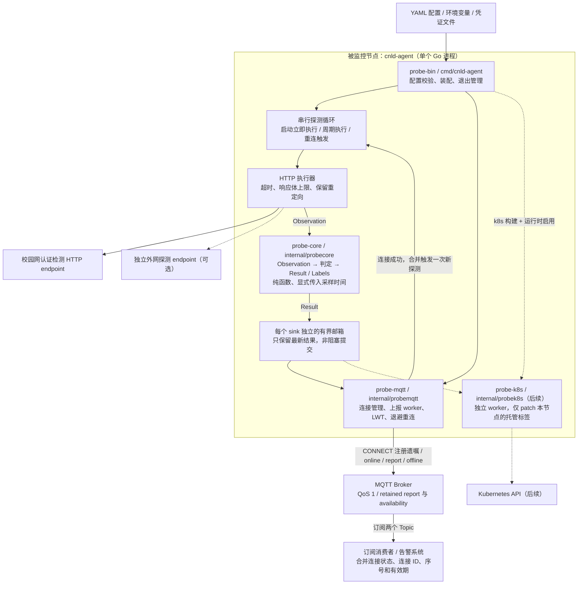
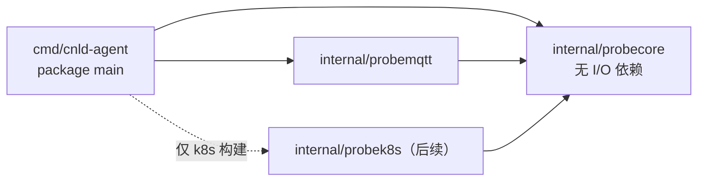
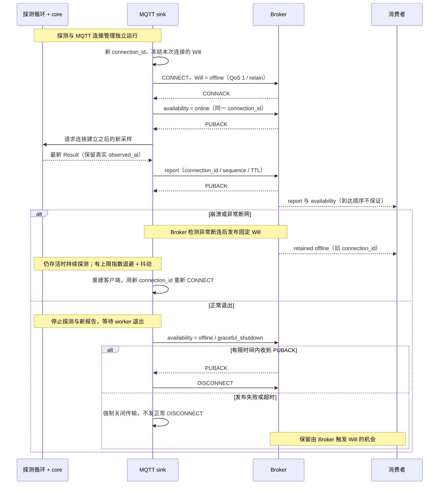
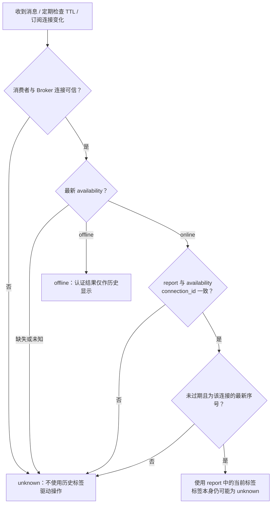

[参考](https://gist.github.com/0702hjj/fb61ffd44072fb8e0ba95c545c7dff6a)

[逐步实现指导书](IMPLEMENTATION_GUIDE.md)：面向只有 C 基础的读者，先用约 1 分钟解释设计，再按每节约 10 分钟完成 Go、HTTP、MQTT 与部署实验。参考实现保存在指导书代码块中，供逐节动手实现。

## Architecture（Go 实现设计）

本节依据上述 `cnld-requirements.md`（查阅日期：2026-10-28）设计，描述待实现的架构。首期交付单个 Go module、单个 `cnld-agent` 二进制，在 Linux 主机、虚拟机或 OCI 容器中独立运行，通过 MQTT 上报校园网状态。Kubernetes 是后续可选 sink；自动登录、修复脚本、调度器和监控 UI 不在首期范围内。

### 运行架构

下图箭头表示运行时的数据或控制流，虚线表示后续能力。



认证状态、外网可达性和 Agent 连接可用性独立建模：

| 维度 | 值 | 负责组件与判定边界 |
| --- | --- | --- |
| `authenticated` | `true / false / unknown` | core 根据明确规则判定；超时、DNS/连接错误和未知响应均为 `unknown`；只有命中明确未认证规则或已识别门户才为 `false` |
| `external_access` | `reachable / blocked / unknown` | 由独立外网探测判定，首期未启用时为 `unknown`；不从认证结果推断 |
| `availability` | `online / offline / unknown` | MQTT 连接生命周期与消费者可信度判断；LWT 仅表示连接离线，不修改认证结果 |

### Go 包与依赖边界

采用按职责组织的包和直接构造函数装配。先将 HTTP、配置和循环放在入口包的辅助文件中；复杂度增长后再拆 adapter 包。`cmd` + `internal` 的选择依据 [Go 官方 module 布局指南](https://go.dev/doc/modules/layout)，下列具体分包是结合本项目需求的设计。

```text
.
├── go.mod                         # 单一 module，具体依赖版本在实现时锁定
├── cmd/cnld-agent/
│   ├── main.go                    # 配置装配、signal、生命周期
│   ├── config.go                  # YAML / env 加载及校验
│   ├── validate.go                # 启动时检查配置与规则
│   ├── http.go                    # HTTP Observation 采集
│   ├── run.go                     # 探测循环、每 sink 有界分发
│   ├── sinks_default.go           # 后续：//go:build !k8s；拒绝启用 K8s
│   └── sinks_k8s.go               # 后续：//go:build k8s；装配 K8s
├── cmd/cnld-watch/                # 实验订阅工具：合并状态、定期检查 TTL
├── cmd/fake-campus/               # 实验 HTTP 接口，不随 Agent 启动
├── cmd/fake-link/                 # 实验丢包代理，不随 Agent 启动
├── internal/
│   ├── probecore/                 # 状态、规则、纯判定、状态转换、标签映射
│   ├── probemqtt/                 # MQTT 报文、连接管理、publish、重连
│   └── probek8s/                  # 后续：源码受 k8s build tag 约束
├── configs/                       # 示例配置，无明文凭证
├── deploy/                        # systemd / OCI；后续 K8s 清单
└── tests/integration/             # Broker 生命周期与消费者验证
```

下图箭头表示 **Go import 方向**，与上面的运行时数据流区分。



- core 接收 `Observation`、规则及显式时间，返回 `Result`；不读时钟、配置或文件，不访问 HTTP、MQTT、K8s。MQTT 的 `connection_id` 和 `sequence` 由 sink 封装，不混入认证判定。
- wiring 使用小接口隔离探测执行与 sink 投递；接口由调用方按实际需要定义，以便注入 fake，遵循 [Go 小接口与行为抽象的惯例](https://go.dev/doc/effective_go#interfaces_and_types)。不提前建立通用插件框架。
- 首期不创建空的 K8s 包或装配文件，配置校验只接受 MQTT。后续引入 K8s 时，再通过互斥的 `k8s` / `!k8s` 构建文件装配，确保默认二进制依赖图没有 K8s 客户端。未编译却配置 K8s 时启动失败。依据：[Go build constraints](https://pkg.go.dev/cmd/go#hdr-Build_constraints)。

### 探测、并发与故障隔离

1. 启动时校验稳定且唯一的 `node_id`（仅字母、数字、点、下划线、连字符）、启用的 sinks、URL、规则歧义、超时、周期和有效期；非法配置直接退出。认证成功规则与未认证规则不能同时命中。
2. 启动立即探测，之后周期执行。串行执行避免采样重叠；重连请求用容量为 1 的通知合并，正在采样时记录待执行请求，不创建无限 goroutine。状态变化完成判定后立即投递；未变化也在每轮投递，以刷新报告有效期。
3. HTTP 复用配置好的 `http.Client` / `Transport`；用 `NewRequestWithContext` 传递取消与 deadline，设置整体及必要的阶段超时。`CheckRedirect` 返回 `http.ErrUseLastResponse`，读取有上限的响应体并关闭 body；截断的 body 不作为完整匹配证据。参见 [net/http 官方文档](https://pkg.go.dev/net/http)。
4. 探测循环不等待 MQTT ACK。每个 sink 的 worker 读取独立的最新结果邮箱；首期用容量为 1 的 channel，由串行探测循环作为唯一发送者，worker 作为唯一接收者，满时替换旧结果。发布有超时，失败仅记录错误并进入重连，不终止探测或拖住其他 sink。关闭客户端的离线发布和自动重连，一次只发布一份报告并等待 ACK，使内部在途消息同样有界。
5. `signal.NotifyContext` 接收 SIGINT/SIGTERM，用同一取消信号停止探测循环和上报循环。探测函数返回后再次检查取消，不再投递结果；worker 停止取新报告，使用独立且有截止时间的清理 context 执行 MQTT 离线发布。主函数等待两个循环退出。参见 [os/signal](https://pkg.go.dev/os/signal#NotifyContext)。

### MQTT 连接与报告生命周期

默认 Topic 为 `cnld/nodes/<node_id>/report` 和 `cnld/nodes/<node_id>/availability`，均为 JSON、QoS 1、retain=true。协议基线为 MQTT 3.1.1；Will、Keep Alive、QoS 1、Retain 和 DISCONNECT 的行为遵循 [OASIS MQTT 3.1.1](https://docs.oasis-open.org/mqtt/mqtt/v3.1.1/os/mqtt-v3.1.1-os.html)（§3.1.2、§3.3、§3.14、§4.3）。



MQTT sink 独占连接生命周期和序号；同一连接内序号递增，同一报告重试使用相同序号。重连会丢弃待发送的旧连接报告，并在新连接上只发布重连后采样的结果，不能给旧样本换时间或换连接标识后当成新样本。旧连接回调不能影响新连接。Keep Alive 建议 30s，必须大于零；遗嘱无法携带未来真实断线时间，也不提供固定的端到端告警时限。

具体实现中，online 被确认后记录 `readyAt` 并触发采样，丢弃邮箱中采样开始时间早于 `readyAt` 的结果。这也覆盖“重连时上一轮采样尚未结束”的情况。进程内比较保留 `time.Time` 的单调时钟部分，生成 JSON 时再转 UTC；每个连接使用独立的断连通知 channel，旧回调不能影响新连接。

指导书使用 [Eclipse Paho Go MQTT 3.1.1 client](https://github.com/eclipse-paho/paho.mqtt.golang) `v1.5.1` 作为实验参考，由 sink 管理退避与每次连接的客户端重建，避免库自动重连复用旧 Will 的 `connection_id`。通过自定义连接函数保存底层 socket；离线发布失败时先关闭 socket，再清理客户端，避免正常 DISCONNECT 抑制遗嘱。连接回调仅通知 worker，不在回调中执行阻塞探测或等待发布。

### 消费者如何建立当前可信状态

订阅示例必须演示以下合并规则；retained 只提供最后一份数据，不表示数据仍然新鲜。



消费者按连接 ID 与序号幂等处理 QoS 1 重复消息；较小或相同序号不会覆盖已有报告。有效期为 `observed_at + valid_for_seconds`，需同步 Agent 与消费者时钟，并主动定时检查过期。任一 Topic 先到时等待另一方匹配；消费者断网或 Broker 重启后先恢复订阅并重新验证可信状态。LWT 与 TTL 配合，覆盖 Broker 故障及 MQTT 在线但探测停滞的情况。

### 部署边界与验收

- Agent 使用被监控节点的网络出口；Linux 容器优先 host networking，并验证实际源 IP。显式控制探测代理配置，避免环境代理改变被测出口。Broker 宜位于未认证节点仍可访问的网络；否则 offline 只能说明连接不可用。
- MQTT 默认验证 TLS 服务端证书，支持自定义 CA 与客户端证书；凭证来自环境变量或文件。Broker ACL 限制到本节点两个 Topic（含 Will 权限），部署时验证 retained 持久化。日志记录节点、变化、错误类别和重连事件，不记录凭证或完整敏感响应体。
- core 使用无 I/O 的表驱动测试覆盖成功、未认证、门户、普通重定向、错误及未知响应；HTTP 用 `httptest` 验证超时、响应体上限和重定向保留。循环测试验证串行采样、最新值覆盖、Broker 故障隔离及退出取消。
- MQTT 用真实 Broker 做集成验证：新订阅者 retained 消息、强杀、丢弃网络包、正常退出、重连新 ID、离线发布失败，以及重复、跨 Topic 乱序、过期和探测停止。Broker 重启与消费者断网后必须重新建立可信状态。
- Go 实现阶段运行 `go test ./...`、`go test -race ./...`、`go vet ./...`；检查默认入口的 `go list -deps` 不含 K8s 客户端，交付 Linux amd64/arm64 二进制与 OCI 镜像。当前仓库仅为设计文档，上述目录与检查均为实施计划。
- 后续 K8s sink 只 patch CNLD 管理的标签；未知映射为 `unknown`。Node Label 没有 TTL，须另行设计结合 Node Ready 与控制器的失效策略，MQTT LWT 不会自动清理标签。
